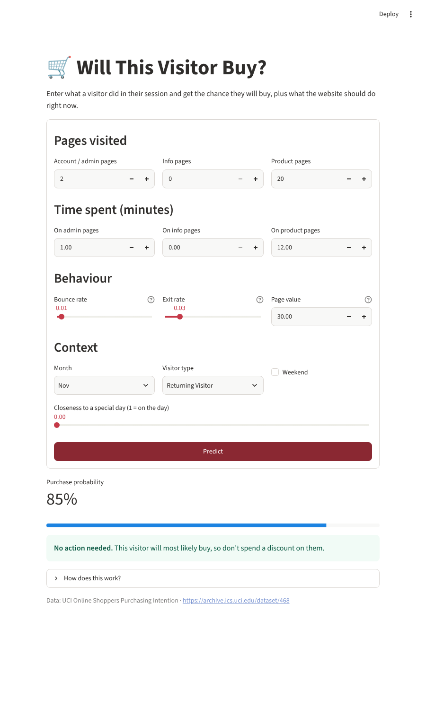

# 🛒 Will This Visitor Buy? Real-Time Purchase Intent

Most online-store visitors leave without buying. This project predicts, from a single browsing session, whether a visitor will purchase, and tells the website what to do next: **no action, show a coupon, or open a chat**.

**Live app:** https://purchase-intent-predictor-ojq2b5uxxzu8x4krcfdstf.streamlit.app



## Results (untouched test set, 2,466 sessions)

| Model | Accuracy | Precision | Recall | F1 | ROC-AUC |
|---|---|---|---|---|---|
| Baseline (always "no purchase") | 0.845 | 0.000 | 0.000 | 0.000 | 0.500 |
| **Gradient Boosting (tuned, threshold 0.68)** | **0.895** | **0.646** | **0.707** | **0.675** | **0.930** |

5-fold CV ROC-AUC on training data: Random Forest 0.931 · Gradient Boosting 0.931 · Logistic Regression 0.921 · Decision Tree 0.907.

The baseline shows why accuracy is misleading here: it scores 84.5% while finding zero buyers.

## Key insights
- **PageValues** is the strongest signal: sessions with PageValues > 0 buy 56% of the time vs 4% when it's 0.
- **November** has the highest buy rate (25%) and **February** the lowest (1.6%).
- **New visitors** convert more than returning ones (25% vs 14%).
- 74% of the buyers the model misses had PageValues = 0, meaning they bought without the usual path, so their sessions look like plain browsing.

## Data
[UCI Online Shoppers Purchasing Intention](https://archive.ics.uci.edu/dataset/468): 12,330 sessions from one year of a real online store, 17 features, 15.5% buyers.

## What's inside
| File | |
|---|---|
| `purchase_intent.ipynb` | Full workflow: framing → EDA → pipeline → 4 models + baseline → grid search → threshold choice → test evaluation → error analysis → business recommendation |
| `features.py` | Feature engineering shared by the notebook and the app |
| `app.py` | Streamlit app |
| `model.joblib` | Saved final pipeline + threshold |

## How to run
```bash
pip install -r requirements.txt
# download online_shoppers_intention.csv into data/ (only needed for the notebook)
jupyter notebook purchase_intent.ipynb
streamlit run app.py
```

## Limitations
One store, one year (no January or April data). PageValues is only known after some browsing, so predictions are weaker very early in a session. The model shows correlation; the real effect of a coupon needs an A/B test.

**Tools:** Python, pandas, scikit-learn, matplotlib, seaborn, Streamlit
